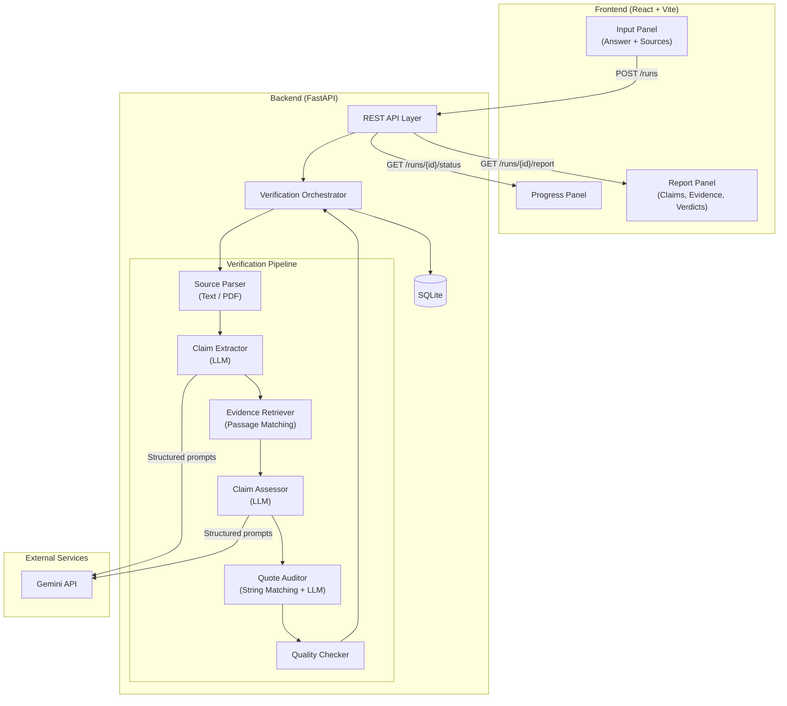
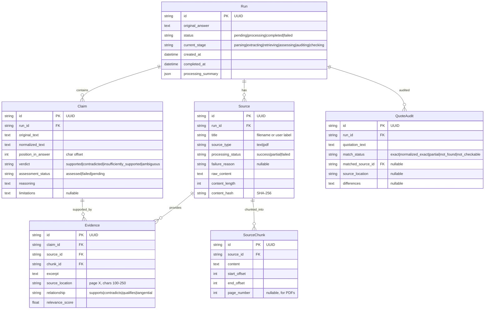

# Second Opinion — Implementation Plan

## A. Repository Assessment

### Current State

| Dimension | Finding |
|---|---|
| Repository | `d:\bitnbuild` — **completely empty**, no files, no hidden configs |
| Node.js | v24.15.0 ✅ |
| npm / npx | 11.12.1 ✅ |
| Python | 3.14.2 ✅ |
| pip | 25.3 (via `python -m pip`) ✅ |
| git | **Not available** on PATH ⚠️ |
| OS | Windows |

### Implications

- **Greenfield project** — no existing code to preserve or extend.
- We choose the stack from scratch; recommendations below are based on the product requirements and available runtimes.
- Git not on PATH means version control setup may need manual attention (install Git for Windows or use VS Code's bundled Git). This is non-blocking for implementation but important for collaboration.

---

## B. Recommended Architecture

### Stack Selection

| Layer | Choice | Rationale |
|---|---|---|
| **Frontend** | React 18 via **Vite** | Fast dev server, simple setup, no SSR needed for this MVP |
| **Backend** | Python **FastAPI** | Excellent async support, automatic OpenAPI docs, native Pydantic validation |
| **LLM Provider** | **Google Gemini API** (configurable) | Single provider, strong structured-output support. Swap via env var. |
| **PDF Parsing** | **PyMuPDF (fitz)** | Fast, reliable text extraction with page-level positioning, no Java/Tika dependency |
| **Storage** | **SQLite** via SQLAlchemy | Zero-config, file-based, sufficient for single-server hackathon demo |
| **Testing** | pytest (backend), Vitest (frontend) | Standard, fast, minimal config |

> [!IMPORTANT]
> No vector database, no task queue, no multi-agent framework, no complex auth. Every component is a single process.

### System Diagram



### Data Flow — Happy Path

```
1. User pastes answer + sources → POST /api/runs
2. Backend creates run record, parses sources, stores passages → DB
3. Backend calls LLM to extract claims → stores claims → DB
4. For each claim: retrieve relevant passages from stored source content
5. Backend calls LLM to assess each claim against passages → verdict + reasoning → DB
6. Backend audits quotations via string matching → DB
7. Quality checker validates all references and coverage → DB
8. Frontend polls GET /api/runs/{id}/status until complete
9. Frontend fetches GET /api/runs/{id}/report and renders claim cards
```

---

## C. Implementation Roadmap

### Phase 0 — Repository & Environment Setup
**Effort:** ~2 hours · **Parallelizable:** No (foundational)

| Task | Files / Modules | Acceptance Criteria |
|---|---|---|
| Initialize Vite React app in `frontend/` | `frontend/*` | `npm run dev` serves a blank page |
| Initialize FastAPI project in `backend/` | `backend/*`, `requirements.txt` | `uvicorn main:app` returns `{"status": "ok"}` at `/health` |
| Create `.env.example` with required env vars | `.env.example` | Documents `GEMINI_API_KEY`, `DATABASE_URL` |
| Create project README with setup instructions | `README.md` | A new teammate can run both servers in <5 min |
| Setup SQLite database initialization | `backend/database.py` | Tables auto-create on first run |
| Create shared constants/types | `backend/models/`, `frontend/src/types/` | Verdict enum, status enum defined in both layers |

**Tests:** Backend health endpoint returns 200. Frontend dev server starts without errors.

**Risks:** Python 3.14 compatibility with some packages. **Mitigation:** Pin package versions, test imports early.

---

### Phase 1 — End-to-End Skeleton
**Effort:** ~4–5 hours · **Parallelizable:** Frontend + Backend after API contract agreed  
**Depends on:** Phase 0

| Task | Files / Modules | Acceptance Criteria |
|---|---|---|
| Define SQLAlchemy models for `Run`, `Source`, `Claim`, `Evidence`, `QuoteAudit` | `backend/models/schema.py` | Models create tables, FK constraints enforced |
| Implement `POST /api/runs` — accept answer + pasted text sources | `backend/routes/runs.py` | Returns run ID, stores answer and sources |
| Implement `GET /api/runs/{id}/status` — return run status | `backend/routes/runs.py` | Returns current pipeline stage |
| Implement `GET /api/runs/{id}/report` — return full report | `backend/routes/reports.py` | Returns structured JSON with claims, evidence, verdicts |
| Build stub orchestrator that runs pipeline stages sequentially | `backend/services/orchestrator.py` | Calls each stage, updates status, handles errors |
| Build Input UI — answer textarea + source text area + submit | `frontend/src/pages/InputPage.jsx` | User can paste answer + source and submit |
| Build Results UI — skeleton cards showing claim + verdict | `frontend/src/pages/ReportPage.jsx` | Renders JSON from API into readable cards |
| Implement API client module | `frontend/src/api/client.js` | Wraps fetch calls, handles errors |
| Implement polling for run status | `frontend/src/hooks/useRunStatus.js` | UI updates when run completes |

**Tests:**
- Submit pasted text → receive run ID → poll → get report with stub data.
- Submit empty answer → receive 422 validation error.
- Submit answer with no sources → receive 422.

**Deliverable:** A working (stub-data) loop from input → processing → report display.

---

### Phase 2 — Claim Extraction
**Effort:** ~4 hours · **Parallelizable:** Yes (backend-only, frontend can polish Phase 1 UI)  
**Depends on:** Phase 1

| Task | Files / Modules | Acceptance Criteria |
|---|---|---|
| Design claim extraction prompt with structured output schema | `backend/prompts/claim_extraction.py` | Prompt template with JSON output spec |
| Implement Gemini API client with retry + timeout | `backend/services/llm_client.py` | Configurable model, handles errors/rate limits |
| Implement claim extractor service | `backend/services/claim_extractor.py` | Extracts atomic claims, assigns stable IDs, preserves original text |
| Parse and validate LLM structured output | `backend/services/claim_extractor.py` | Rejects malformed output, retries once |
| Store extracted claims in DB with original + normalized text | `backend/models/schema.py` (Claim) | Claims queryable by run ID |
| Add claims list to report API response | `backend/routes/reports.py` | Report JSON includes claims array |
| Display extracted claims in frontend | `frontend/src/components/ClaimCard.jsx` | Each claim shown with original text |

**Tests:**
- Single-sentence answer → 1 claim extracted.
- Compound sentence ("X and Y") → 2+ claims extracted.
- Answer with dates/units → claims preserve "as of 2024", "15.7 million", etc.
- LLM returns malformed JSON → service retries, then records extraction failure.

**Risks:** LLM may merge or split claims inconsistently. **Mitigation:** Prompt engineering with few-shot examples; add a manual claim-edit UI in Phase 6 if time allows.

---

### Phase 3 — Evidence Retrieval
**Effort:** ~4–5 hours · **Parallelizable:** Yes (backend-only)  
**Depends on:** Phase 2

| Task | Files / Modules | Acceptance Criteria |
|---|---|---|
| Implement source chunker — split text into overlapping passages | `backend/services/source_chunker.py` | Chunks preserve paragraph boundaries, track char offsets |
| Store chunks with source ID + location metadata | `backend/models/schema.py` (SourceChunk) | Chunks queryable by source ID |
| Implement passage retrieval via keyword/TF-IDF matching | `backend/services/evidence_retriever.py` | Returns top-K relevant passages per claim |
| Attach source ID + location to every retrieved passage | `backend/services/evidence_retriever.py` | No passage exists without a valid source reference |
| Store evidence records in DB | `backend/models/schema.py` (Evidence) | Evidence linked to claim ID + source ID |

**Retrieval Strategy (MVP):**
Use TF-IDF (scikit-learn `TfidfVectorizer`) with cosine similarity. This avoids embedding model dependencies and is sufficient for passages under ~50 pages total. If retrieval quality is poor in testing, upgrade to sentence embeddings as a Phase 6+ improvement.

**Tests:**
- Source contains "Python was created by Guido van Rossum" → claim about Python's creator retrieves that passage.
- Claim about topic X, source only about topic Y → no highly relevant passages returned.
- Verify every evidence record has a valid source_id pointing to a successfully processed source.

**Risks:** TF-IDF may miss semantic matches. **Mitigation:** Use generous top-K (e.g., 10) and rely on the LLM assessor in Phase 4 to filter irrelevant passages.

---

### Phase 4 — Verdict Generation
**Effort:** ~5–6 hours · **Parallelizable:** Partially (prompt design can parallel with frontend)  
**Depends on:** Phase 3

| Task | Files / Modules | Acceptance Criteria |
|---|---|---|
| Design assessment prompt — claim + passages → verdict + reasoning | `backend/prompts/claim_assessment.py` | Structured output: verdict, reasoning, limitations, evidence refs |
| Implement claim assessor service | `backend/services/claim_assessor.py` | Processes each claim, returns one of 4 verdicts |
| Handle assessment failures → operational status | `backend/services/claim_assessor.py` | Failed assessments marked `"assessment_failed"`, not a verdict |
| Implement missing-evidence-as-insufficient logic | `backend/services/claim_assessor.py` | No passages → `"insufficiently_supported"`, never `"contradicted"` |
| Update report with verdicts, reasoning, evidence excerpts | `backend/routes/reports.py` | Full claim-level results in API response |
| Build verdict badge + reasoning display in frontend | `frontend/src/components/VerdictBadge.jsx` | Color-coded badges: green/red/yellow/orange |
| Build evidence excerpt component (expandable) | `frontend/src/components/EvidenceExcerpt.jsx` | Shows excerpt, source name, location; expandable |

**Tests:**
- Claim "X is Y" + source says "X is Y" → `supported`.
- Claim "X is Y" + source says "X is Z" → `contradicted`.
- Claim "X is Y" + source says nothing about X → `insufficiently_supported`.
- Claim "X might be Y or Z" + source supports both → `ambiguous`.
- LLM timeout during assessment → operational status, not a verdict.

**Deliverable:** Complete verification pipeline producing real verdicts for pasted-text sources.

---

### Phase 5 — PDF Intake & Quotation Audit
**Effort:** ~4–5 hours · **Parallelizable:** PDF (backend) + Quote audit (backend) can run in parallel  
**Depends on:** Phase 4

| Task | Files / Modules | Acceptance Criteria |
|---|---|---|
| Implement PDF upload endpoint | `backend/routes/sources.py` | Accepts PDF files up to 10MB |
| Implement PDF text extraction with PyMuPDF | `backend/services/pdf_parser.py` | Extracts text with page numbers |
| Detect and report empty/scanned/corrupted PDFs | `backend/services/pdf_parser.py` | Source status: `"failed"` or `"partial"` with reason |
| Store PDF source content + page metadata | `backend/models/schema.py` | Source pages stored with page numbers |
| Implement quotation extraction from the answer | `backend/services/quote_auditor.py` | Finds quoted strings in the original answer |
| Implement exact/normalized string matching against source text | `backend/services/quote_auditor.py` | Matches with whitespace/case normalization |
| Store quote audit results | `backend/models/schema.py` (QuoteAudit) | Each quote: match_status, source, location, diffs |
| Add PDF upload UI | `frontend/src/components/SourceUpload.jsx` | Drag-and-drop + file picker for PDFs |
| Display quote audit results in report | `frontend/src/components/QuoteAuditCard.jsx` | Shows match status per quotation |

**Tests:**
- Upload readable PDF → text extracted, page numbers correct.
- Upload scanned (image-only) PDF → status `"failed"`, reason `"no extractable text"`.
- Upload 0-byte PDF → status `"failed"`.
- Answer contains `"exact quote"` that exists in source → `"exact_match"`.
- Answer contains `"altered quote"` → `"partial_match"` with diff.
- Answer contains quote not in any source → `"not_found"`.

---

### Phase 6 — Report & Interface Refinement
**Effort:** ~4–5 hours · **Parallelizable:** Fully (frontend-heavy)  
**Depends on:** Phase 5

| Task | Files / Modules | Acceptance Criteria |
|---|---|---|
| Build summary header — verdict counts, coverage, limitations | `frontend/src/components/ReportSummary.jsx` | Shows #supported, #contradicted, etc. + source count |
| Build source status panel — which sources processed, which failed | `frontend/src/components/SourcePanel.jsx` | Lists sources with status badges |
| Implement evidence-to-source deep linking | `frontend/src/components/EvidenceExcerpt.jsx` | Click excerpt → highlights passage in source viewer |
| Build source text viewer with highlight | `frontend/src/components/SourceViewer.jsx` | Shows full source text, highlights relevant passage |
| Add "scope disclaimer" to report | `frontend/src/components/ReportDisclaimer.jsx` | States verification is against selected sources only |
| Handle partial failures gracefully in UI | `frontend/src/pages/ReportPage.jsx` | Shows which claims assessed, which failed, which sources unusable |
| Add "rerun" capability — modify sources, re-verify | `frontend/src/pages/InputPage.jsx` | User can remove/add sources and rerun |
| Polish all claim cards — verdict, reasoning, evidence, source loc | `frontend/src/components/ClaimCard.jsx` | All fields visible, expandable excerpts |
| Implement quality checks endpoint | `backend/services/quality_checker.py` | Validates all refs, detects missing claims, broken links |

**Tests:**
- Report with mix of verdicts displays correct counts.
- Failed source shows clear error, not fake "checked" status.
- Rerun with different sources creates a new run, preserves old one.

---

### Phase 7 — Testing & Demo Readiness
**Effort:** ~3–4 hours · **Parallelizable:** Fully  
**Depends on:** Phase 6

| Task | Files / Modules | Acceptance Criteria |
|---|---|---|
| Create evaluation dataset (10–15 test cases) | `backend/tests/eval_data/` | Covers all verdict types, edge cases |
| Run full pipeline on eval dataset, record results | `backend/tests/test_eval.py` | Results documented, accuracy measured |
| Fix critical failures found in eval | Various | All test cases produce valid output |
| Write integration test for complete pipeline | `backend/tests/test_pipeline.py` | End-to-end test passes |
| Prepare demo script with 2–3 scenarios | `docs/demo_script.md` | Repeatable demo takes <5 minutes |
| Document known limitations | `docs/limitations.md` | Honest disclosure of what doesn't work |
| Final UI polish — loading states, error messages, responsive | `frontend/src/` | No broken UI states during demo |

---

## D. API & Data Contracts

### Data Model



### API Endpoints

| Method | Path | Purpose |
|---|---|---|
| `POST` | `/api/runs` | Create a new verification run |
| `GET` | `/api/runs/{run_id}/status` | Poll processing status |
| `GET` | `/api/runs/{run_id}/claims` | Get extracted claims (after extraction stage) |
| `PATCH` | `/api/runs/{run_id}/claims/{claim_id}` | Edit a claim's normalized text (optional MVP feature) |
| `GET` | `/api/runs/{run_id}/report` | Get full verification report |
| `POST` | `/api/runs/{run_id}/sources` | Upload additional source (PDF) |
| `GET` | `/api/runs/{run_id}/sources` | List sources with processing status |

### Example JSON — Create Run

**Request:** `POST /api/runs`
```json
{
  "answer": "Python was created by Guido van Rossum in 1991. It is the most popular programming language as of 2024, with over 20 million developers worldwide.",
  "sources": [
    {
      "title": "Python Wikipedia Article",
      "type": "text",
      "content": "Python is a high-level programming language. Its design philosophy emphasizes code readability. Python was conceived in the late 1980s by Guido van Rossum at Centrum Wiskunde & Informatica (CWI) in the Netherlands. Its first release was in 1991."
    }
  ]
}
```

**Response:** `201 Created`
```json
{
  "run_id": "a1b2c3d4-e5f6-7890-abcd-ef1234567890",
  "status": "processing",
  "current_stage": "parsing",
  "created_at": "2026-10-11T01:15:00Z",
  "sources": [
    {
      "id": "src-001",
      "title": "Python Wikipedia Article",
      "type": "text",
      "processing_status": "success"
    }
  ]
}
```

### Example JSON — Successful Report

**Response:** `GET /api/runs/{run_id}/report`
```json
{
  "run_id": "a1b2c3d4-e5f6-7890-abcd-ef1234567890",
  "status": "completed",
  "original_answer": "Python was created by Guido van Rossum in 1991. It is the most popular programming language as of 2024, with over 20 million developers worldwide.",
  "summary": {
    "total_claims": 3,
    "supported": 1,
    "contradicted": 0,
    "insufficiently_supported": 2,
    "ambiguous": 0,
    "assessment_failures": 0,
    "sources_processed": 1,
    "sources_failed": 0,
    "coverage_note": "2 of 3 claims had no relevant evidence in the supplied sources."
  },
  "claims": [
    {
      "id": "clm-001",
      "original_text": "Python was created by Guido van Rossum in 1991",
      "normalized_text": "Python was created by Guido van Rossum in 1991",
      "verdict": "supported",
      "assessment_status": "assessed",
      "reasoning": "The source confirms both the creator (Guido van Rossum) and the first release year (1991). The source uses 'conceived in the late 1980s' for the design phase but states the first release was 1991, consistent with the claim.",
      "limitations": null,
      "evidence": [
        {
          "id": "ev-001",
          "source_id": "src-001",
          "source_title": "Python Wikipedia Article",
          "excerpt": "Python was conceived in the late 1980s by Guido van Rossum at Centrum Wiskunde & Informatica (CWI) in the Netherlands. Its first release was in 1991.",
          "source_location": "chars 134-296",
          "relationship": "supports"
        }
      ]
    },
    {
      "id": "clm-002",
      "original_text": "It is the most popular programming language as of 2024",
      "normalized_text": "Python is the most popular programming language as of 2024",
      "verdict": "insufficiently_supported",
      "assessment_status": "assessed",
      "reasoning": "The supplied source does not contain any information about programming language popularity rankings or 2024 statistics.",
      "limitations": "This claim may be verifiable with additional sources not included in this run.",
      "evidence": []
    },
    {
      "id": "clm-003",
      "original_text": "with over 20 million developers worldwide",
      "normalized_text": "Python has over 20 million developers worldwide",
      "verdict": "insufficiently_supported",
      "assessment_status": "assessed",
      "reasoning": "The supplied source does not mention developer counts or worldwide adoption statistics.",
      "limitations": "This claim may be verifiable with additional sources not included in this run.",
      "evidence": []
    }
  ],
  "quote_audits": [],
  "scope_disclaimer": "This verification is based solely on the 1 source(s) supplied for this run. It does not represent a universal fact-check."
}
```

### Example JSON — Source Processing Failure

```json
{
  "id": "src-002",
  "title": "annual_report.pdf",
  "type": "pdf",
  "processing_status": "failed",
  "failure_reason": "PDF contains only scanned images with no extractable text. OCR is not supported in this version."
}
```

### Example JSON — Insufficiently Supported Claim (key distinction)

```json
{
  "id": "clm-005",
  "original_text": "The company's revenue grew 40% year-over-year",
  "verdict": "insufficiently_supported",
  "assessment_status": "assessed",
  "reasoning": "The supplied source discusses the company's product launches but does not contain revenue figures or growth metrics.",
  "limitations": "Revenue data may be present in financial reports not included in this verification run.",
  "evidence": []
}
```

> [!NOTE]
> This is classified as "insufficiently_supported" — NOT "contradicted". Missing evidence ≠ contradiction. This is a core product rule.

---

## E. Team Task Breakdown

### Workstream Map

```mermaid
gantt
    title Second Opinion — Parallel Workstreams
    dateFormat  HH:mm
    axisFormat  %H:%M

    section Shared
    Phase 0 - Setup                    :p0, 00:00, 2h
    API Contract Agreement             :p0api, after p0, 30m

    section Backend (Dev 1 + Dev 2)
    DB Models + API Skeleton           :p1b, after p0api, 3h
    Claim Extraction Service           :p2, after p1b, 4h
    Evidence Retrieval Service         :p3, after p2, 4h
    Verdict Generation Service         :p4, after p3, 5h
    PDF Parser + Quote Auditor         :p5, after p4, 4h
    Quality Checker                    :p6b, after p5, 2h

    section Frontend (Dev 3)
    Input Page + API Client            :p1f, after p0api, 3h
    Claim Cards + Verdict Badges       :p2f, after p1f, 3h
    Evidence Excerpts + Source Panel    :p4f, after p2f, 3h
    PDF Upload UI                      :p5f, after p4f, 2h
    Report Polish + Source Viewer      :p6f, after p5f, 4h

    section Testing (All)
    Eval Dataset + Integration Tests   :p7, after p6b, 3h
```



### Role Assignments

| Workstream | Owner(s) | Modules |
|---|---|---|
| **Backend Core** (API, DB, Orchestrator) | Dev 1 | `routes/`, `models/`, `services/orchestrator.py`, `database.py` |
| **AI Pipeline** (LLM client, Extraction, Assessment, Prompts) | Dev 2 | `services/llm_client.py`, `services/claim_extractor.py`, `services/claim_assessor.py`, `prompts/` |
| **Source Processing** (Chunker, Retriever, PDF, Quotes) | Dev 2 | `services/source_chunker.py`, `services/evidence_retriever.py`, `services/pdf_parser.py`, `services/quote_auditor.py` |
| **Frontend** | Dev 3 | `frontend/src/` |
| **Testing & Eval** | All | `backend/tests/`, `docs/` |

### Critical Integration Points

1. **API contract** (Phase 0 end) — Must be agreed before frontend and backend diverge.
2. **Claim schema** (Phase 2 start) — Backend and frontend must agree on claim JSON shape.
3. **Report schema** (Phase 4 end) — Full report JSON structure must be frozen for frontend to build cards.
4. **Source upload multipart format** (Phase 5 start) — Frontend and backend must agree on file upload API.

---

## F. Risk Register

| # | Risk | Severity | Likelihood | Detection | Mitigation | Scope Reduction |
|---|---|---|---|---|---|---|
| R1 | **LLM returns inconsistent/malformed structured output** | High | High | Pydantic validation on every response | Few-shot prompting, retry once, strict JSON schema | Hardcode fallback claim extraction with regex |
| R2 | **Claim extraction splits or merges claims unpredictably** | Medium | High | Eval dataset comparison | Iterative prompt tuning, few-shot examples | Accept imperfect splitting, allow manual edit |
| R3 | **TF-IDF retrieval misses semantic matches** | Medium | Medium | Eval dataset recall measurement | Generous top-K (10), rely on assessor to filter | Upgrade to sentence-transformers embeddings |
| R4 | **Python 3.14 package compatibility** | Medium | Medium | Import errors at setup | Pin versions, test early, use 3.12 if critical failures | Use older Python if available |
| R5 | **Gemini API rate limits during demo** | High | Low | 429 responses | Implement exponential backoff, cache results | Pre-run demo scenarios, show cached results |
| R6 | **PDF parsing yields garbled text** | Medium | Medium | Visual inspection of extracted text | Use PyMuPDF's layout-preserving mode | Limit MVP to "readable PDF" and disclose failures |
| R7 | **Long answers (>50 claims) cause timeout** | Medium | Low | Latency monitoring | Process claims in batches, set 5-min timeout | Limit to first 20 claims with disclosure |
| R8 | **Frontend–backend schema drift** | Medium | Medium | TypeScript types vs Pydantic models | Generate OpenAPI spec, frontend types from spec | Manual sync at each phase boundary |
| R9 | **Git unavailable for team collaboration** | Low | Confirmed | Already detected | Install Git for Windows, or use shared folder | Single-developer workflow |

---

## G. MVP Acceptance Checklist

### ✅ Must-Have for Demo

- [ ] User can paste an AI-generated answer into the interface
- [ ] User can provide at least one reference source as pasted text
- [ ] User can upload a readable text-based PDF as a source
- [ ] System extracts individual factual claims from the answer
- [ ] System retrieves relevant passages from supplied sources only
- [ ] Each claim receives one of the four verdicts (supported, contradicted, insufficiently supported, ambiguous)
- [ ] Each verdict includes a short reasoning explanation
- [ ] Each verdict links to the specific evidence excerpt and source location
- [ ] Missing evidence is treated as "insufficiently supported", not "contradicted"
- [ ] Failed/unreadable sources are reported honestly, not silently skipped
- [ ] The original answer is preserved unchanged
- [ ] Report includes a scope disclaimer (sources-only, not universal truth)
- [ ] Report shows summary counts of each verdict type
- [ ] Quotation audit identifies at least exact matches and not-found quotes
- [ ] No external sources or web searches are used
- [ ] API keys are in environment variables, not in code
- [ ] The app runs locally with documented setup steps

### 🔜 Explicitly Deferred

- [ ] User accounts or authentication
- [ ] Persistent run history across sessions (SQLite file persists but no login)
- [ ] Manual claim editing before verification
- [ ] Web URL sources
- [ ] Scanned PDF / OCR support
- [ ] Autonomous web research
- [ ] Multiple LLM providers
- [ ] Vector database
- [ ] Confidence scores (uncalibrated scores are misleading)
- [ ] Export to PDF/JSON
- [ ] Batch/bulk verification
- [ ] Real-time streaming of results
- [ ] Mobile-optimized layout
- [ ] Deployment to cloud hosting

---

## H. Initial Execution Sequence

### First Three Tasks (In Order)

#### Task 1: Agree on API Contract & Data Shapes (30 min, all devs)

> [!IMPORTANT]
> This must happen FIRST. Every subsequent parallel task depends on these shared interfaces.

- Review and finalize the API endpoints table (Section D).
- Review and finalize the JSON response shapes for `/api/runs`, `/api/runs/{id}/status`, `/api/runs/{id}/report`.
- Agree on the verdict enum values and assessment status values.
- Create a shared TypeScript types file and a Python Pydantic models file that both teams reference.

**Output:** Committed `backend/models/schemas.py` and `frontend/src/types/api.ts` files.

#### Task 2: Initialize Both Projects (1.5 hours, split)

- **Dev 1:** Initialize FastAPI project in `backend/`, set up SQLAlchemy + SQLite, implement `/health` and stub `POST /api/runs`, create `.env.example`.
- **Dev 3:** Initialize Vite React app in `frontend/`, install dependencies, create input page layout with answer textarea and source text area.
- Both verify: frontend can call backend's `/health` endpoint (configure CORS).

**Output:** Both servers start, frontend can reach backend.

#### Task 3: Build the First Working Loop (2–3 hours, split)

- **Dev 1:** Implement real `POST /api/runs` that stores data in SQLite, `GET /api/runs/{id}/status`, and `GET /api/runs/{id}/report` returning stored (not yet verified) data.
- **Dev 2:** Implement `llm_client.py` with Gemini API integration, test with a simple prompt to verify API key and connectivity.
- **Dev 3:** Implement form submission calling `POST /api/runs`, status polling with `useRunStatus` hook, and basic report page rendering the JSON response.

**Output:** User can submit → see processing → see a stub report. LLM connectivity proven.

---

## I. Evaluation Plan

### Test Dataset Specification (15 cases)

| # | Scenario | Answer Claim | Source Content | Expected Verdict | Reason |
|---|---|---|---|---|---|
| 1 | Simple supported fact | "Earth orbits the Sun" | "Earth revolves around the Sun once per year" | Supported | Direct semantic match |
| 2 | Direct contradiction | "Water boils at 50°C" | "Water boils at 100°C at standard pressure" | Contradicted | Conflicting numeric value |
| 3 | No relevant evidence | "Tesla was founded in 2003" | Article about SpaceX, no Tesla mention | Insufficiently supported | Topic not covered |
| 4 | Misleading paraphrase | "Einstein invented the light bulb" | "Einstein published the theory of relativity" | Insufficiently supported | Source mentions Einstein but not light bulbs |
| 5 | Missing qualifier | "Humans have 23 chromosomes" | "Humans have 23 pairs of chromosomes (46 total)" | Contradicted | Missing "pairs" changes meaning |
| 6 | Exact quotation match | Answer quotes: "To be or not to be" | Source contains exact text | Quote: exact_match | String match succeeds |
| 7 | Altered quotation | Answer quotes: "To be or to not be" | Source: "To be or not to be" | Quote: partial_match | Word order changed |
| 8 | Ambiguous claim | "The project was successful" | Source A: "met targets", Source B: "over budget" | Ambiguous | Conflicting evidence |
| 9 | Date precision | "Founded in 2003" | "Incorporated July 1, 2003" | Supported | Year matches despite different granularity |
| 10 | Quantity with units | "Revenue was $5.2 billion" | "Revenue reached $5.2B in FY2023" | Supported | Same value, different notation |
| 11 | Compound sentence | "X is A and Y is B" | Only supports "X is A", silent on Y | Mixed | Should extract 2 claims, one supported, one insufficient |
| 12 | Scanned PDF source | Any claim | Image-only PDF | Source failed | Should report parsing failure |
| 13 | Empty source | Any claim | Empty text | Source failed | Should report empty source |
| 14 | Conflicting sources | "Population is 1M" | Source A: "1M", Source B: "1.2M" | Ambiguous or Contradicted | Conflicting evidence across sources |
| 15 | Version-specific fact | "Python 3.12 added..." | Source only covers Python 3.10 | Insufficiently supported | Source doesn't cover that version |

### Metrics

| Metric | Target | How to Measure |
|---|---|---|
| Claim extraction recall | ≥ 80% of human-identified claims extracted | Manual count on eval set |
| Claim extraction precision | ≥ 70% of extracted claims are valid atomic claims | Manual review |
| Verdict accuracy | ≥ 75% match human labels | Compare to ground truth |
| False "supported" rate | < 15% | Count supported verdicts for contradicted/insufficient ground truth |
| False "contradicted" rate (from missing evidence) | 0% | No missing evidence → contradicted |
| Evidence location accuracy | ≥ 90% excerpts traceable to correct source | Manual verification |
| Quote match precision | ≥ 90% | Compare to ground truth |
| Source-scope leakage | 0 instances | Grep for external knowledge in reasoning |
| End-to-end latency (3 claims, 1 source) | < 60 seconds | Timed test run |

---

## J. Project File Structure (Proposed)

```
d:\bitnbuild\
├── README.md
├── .env.example
├── .gitignore
│
├── backend/
│   ├── main.py                          # FastAPI app, CORS, lifespan
│   ├── config.py                        # Settings from env vars
│   ├── database.py                      # SQLAlchemy engine, session, init
│   ├── requirements.txt
│   │
│   ├── models/
│   │   └── schemas.py                   # SQLAlchemy models + Pydantic schemas
│   │
│   ├── routes/
│   │   ├── runs.py                      # POST /runs, GET /status
│   │   ├── sources.py                   # POST /sources (PDF upload)
│   │   └── reports.py                   # GET /report
│   │
│   ├── services/
│   │   ├── orchestrator.py              # Pipeline sequencer
│   │   ├── llm_client.py                # Gemini API wrapper
│   │   ├── claim_extractor.py           # Claim extraction logic
│   │   ├── source_chunker.py            # Text chunking with offsets
│   │   ├── evidence_retriever.py        # TF-IDF passage retrieval
│   │   ├── claim_assessor.py            # Verdict generation
│   │   ├── pdf_parser.py                # PyMuPDF text extraction
│   │   ├── quote_auditor.py             # Quotation matching
│   │   └── quality_checker.py           # Final validation
│   │
│   ├── prompts/
│   │   ├── claim_extraction.py          # Extraction prompt templates
│   │   └── claim_assessment.py          # Assessment prompt templates
│   │
│   └── tests/
│       ├── test_pipeline.py             # Integration tests
│       ├── test_claim_extractor.py       # Unit tests
│       ├── test_evidence_retriever.py
│       ├── test_quote_auditor.py
│       └── eval_data/                   # Test dataset JSONs
│           ├── cases.json
│           └── expected_results.json
│
├── frontend/
│   ├── index.html
│   ├── package.json
│   ├── vite.config.js
│   │
│   └── src/
│       ├── main.jsx
│       ├── App.jsx
│       ├── index.css                    # Design system, tokens, animations
│       │
│       ├── types/
│       │   └── api.ts                   # Shared type definitions
│       │
│       ├── api/
│       │   └── client.js                # API wrapper
│       │
│       ├── hooks/
│       │   └── useRunStatus.js          # Polling hook
│       │
│       ├── pages/
│       │   ├── InputPage.jsx            # Answer + source input
│       │   └── ReportPage.jsx           # Full verification report
│       │
│       └── components/
│           ├── ClaimCard.jsx            # Claim + verdict + evidence
│           ├── VerdictBadge.jsx         # Color-coded verdict indicator
│           ├── EvidenceExcerpt.jsx      # Expandable evidence passage
│           ├── SourceUpload.jsx         # PDF/text source input
│           ├── SourcePanel.jsx          # Source status list
│           ├── SourceViewer.jsx         # Full source with highlights
│           ├── QuoteAuditCard.jsx       # Quotation match result
│           ├── ReportSummary.jsx        # Verdict counts + coverage
│           ├── ReportDisclaimer.jsx     # Scope statement
│           └── ProgressBar.jsx          # Pipeline stage indicator
│
└── docs/
    ├── demo_script.md
    └── limitations.md
```

---

## K. Security & Reliability Checklist

| Concern | Implementation |
|---|---|
| API key storage | `GEMINI_API_KEY` in `.env`, loaded via `python-dotenv`, never in frontend |
| File upload validation | Check MIME type, enforce 10MB limit, reject non-PDF files |
| Content as data, not instructions | Source content goes into prompt as quoted data, never as system instructions |
| Prompt injection defense | Source text wrapped in XML-style delimiters, assessed content prefixed with "USER-PROVIDED SOURCE:" |
| LLM output validation | All LLM responses parsed through Pydantic models; reject and retry malformed output |
| Run isolation | All queries scoped by `run_id`; evidence cannot reference sources from other runs |
| Partial failure handling | Orchestrator continues on individual claim/source failure; marks items as failed |
| Timeout | 30s per LLM call, 5min per run total; exceeded = run marked `"timed_out"` |
| Rate limiting | Exponential backoff on 429 from Gemini API; max 3 retries |
| Sensitive data | SQLite file in `backend/data/`, excluded from `.gitignore`; no server-side logging of source content |

---

> [!TIP]
> **Estimated total effort:** ~30–35 developer-hours across all phases. For a 3-person team working in parallel, this is achievable in a focused 12–15 hour hackathon session, with Phase 7 (testing/polish) as the buffer.

**This plan is ready for review. No files have been created or modified.** Once you approve (or request changes), I'll begin implementing Phase 0.
